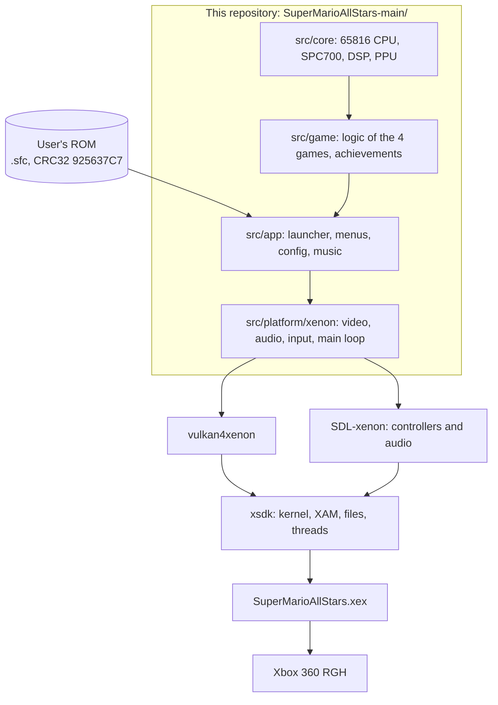

# Super Mario All-Stars for Xbox 360 (RGH)

A port of the [PC port of *Super Mario All-Stars*](SuperMarioAllStars-main/README.md) (Windows, Linux and Android) to
an **Xbox 360 with RGH/JTAG**, as a `.xex` title launched from the dashboard (Aurora, FSD, or retail with homebrew).

The project **contains no cartridge data**: the game runs from the user's own ROM, and the ROM is never uploaded to
the repository. This is an unofficial fan project, not affiliated with or endorsed by Nintendo; *Super Mario* and
related names are trademarks of Nintendo. Please do not ask for, or share, ROM files.

> **Status in one line:** the game already plays on a physical console (launcher, the four games, menus, saves,
> controllers and sound) at 60 fps in 4:3; widescreen and co-op do not yet reach 60 fps in every game, and native
> Xbox 360 achievements and the release package are still to do. Details in [Current status](#current-status).

> **Language note:** this README is in English. The rest of the documentation (`AGENTS.md`, `docs/`, `runs/`) is in
> Spanish.

## Contents

1. [What this is](#what-this-is)
2. [How this port differs from the original](#how-this-port-differs-from-the-original)
3. [How it was built](#how-it-was-built)
4. [Current status](#current-status)
5. [Repository map](#repository-map)
6. [Document index](#document-index)
7. [Building](#building)
8. [Installing on the console](#installing-on-the-console)
9. [Controls on the Xbox 360](#controls-on-the-xbox-360)
10. [Testing and verification](#testing-and-verification)
11. [How work is done in this repository](#how-work-is-done-in-this-repository)
12. [Licenses and credits](#licenses-and-credits)

---

## What this is

*Super Mario All-Stars* (SNES) bundles four games: Super Mario Bros., *The Lost Levels*, Super Mario Bros. 2 and
Super Mario Bros. 3. The PC port (upstream, `github.com/Darhkfox/SuperMarioAllStars`) is not a generic emulator: it is
an SNES emulation core (65816 CPU, SPC700, DSP and PPU) with a "game" layer on top that hooks into the USA ROM's code
to add things the cartridge does not have. This repository brings it to the Xbox 360.

The goal (a "complete port", [`AGENTS.md`](AGENTS.md) §1) is for the Xbox version to have everything the PC version
has, except what the console cannot have:

- the **launcher** (night sky, stars, cards with live previews, Options / Achievements / Music Player / Credits /
  Quit);
- the four games and the All-Stars menu, with battery saves;
- the whole pause menu: save states, Level Select, Cheats, Sound Select, Music Player, Options, Credits;
- **true widescreen** with re-anchored HUDs, colour filters and palette, and **co-op** for SMB1 / Lost Levels / SMB3;
- **rewind** and fast forward;
- the game's **82 achievements**, with their banner, and (as a separate phase) a mirror as native Xbox 360
  achievements;
- a stable 60 fps at 720p and glitch-free audio on the physical console.

What **does not apply** on Xbox (window, configurable VSync, slang shaders, file picker, keyboard...) and what is
adapted is listed in [`AGENTS.md`](AGENTS.md) §6.

### Stack

Imposed by the project's user; not to be changed without asking.

| Part | Tool |
|---|---|
| Build, kernel, XAM, files, threads | **xsdk** (`xsdk-main/`) |
| Graphics | **vulkan4xenon** (`vulkan4xenon-main/`), Vulkan 1.0 on top of xsdk's GPU layer |
| Controllers and audio | **SDL-xenon** (`SDL-xenon-xenon/`, SDL 3.4.10, `xenon` branch) |
| Quick tests on PC | **XSDK Xenia** (`XSDK Xenia/xsdk_xenia.exe`) |
| Byte-order verification | `powerpc-linux-gnu-g++` + `qemu-ppc` in WSL |

These four folders are external repositories: they are **not versioned here** (they are in `.gitignore`) and must sit
next to this README in order to build.



## How this port differs from the original

"Original" means the upstream PC/Linux/Android port (v1.1.1). The games, the emulation core, the 82 achievements, the
widescreen and co-op hooks, cheats, level select and music player are **the same code**; the Xbox port only changes
it where the console requires it, always inside `#if` blocks with the original left in the `#else`, so PC and Android
stay as upstream. What differs:

### Added (not in upstream)

- **A native Xbox 360 title**: `SuperMarioAllStars.xex` with its own title ID (`534D4153`), the name "Super Mario
  All-Stars" and an XDBF resource like a retail game's, so the dashboard can identify it.
- **A complete platform layer** (`src/platform/xenon/`): video and the app's `Canvas` on vulkan4xenon (batched quads,
  text rasterized with `stb_truetype`, fonts embedded in the `.xex`), audio and gamepad input on SDL3, and the main
  loop with a fixed 59.94 Hz pace.
- **Console-specific controls**: the left stick as a D-pad by sectors (so a diagonal no longer reads as Down), Back +
  RB / LB for save and load state, a right-stick click to switch between 4:3 and widescreen, Back + LB + RB held 3 s
  to quit, and the Guide button to pause. Options > Hotkeys lists only what a controller has.
- **A save-slot screen** between the launcher card and the game: the cartridge's four battery files (A-D, with world,
  1P/2P and second-loop star, deletable with X) and a Save States tab with photo and date. States are kept **per
  game** (`saves\states\<game>`), and loading one never overwrites the battery progress.
- **Save & Quit returns to the launcher**, and starting a game is faster: after the first boot the title screen is
  restored from an in-memory snapshot (~415 frames instead of ~770, drawn without rendering) behind a loading screen
  that shows the game cover and the file's world.
- **Default game covers cut from the ROM**: the first time, a hidden console runs the cartridge to its game-select
  screen, crops the four game boxes and saves them to `saves\covers\`. Your own `covers\` still take priority.
- **Launcher tuned for the console**: it starts on the four-game view ("Xbox 360 Edition"); the selected card's
  emulation draws on the render threads and the others run at a fraction of the refresh (or not at all, with covers).
- **Game filters as precompiled shaders**: Nearest, Sharp Bilinear, Bilinear, CRT, CRT aperture, LCD Grid, scanlines
  and curvature are 26 minimal shader variants, one pipeline each, and the colour options (profile, brightness,
  contrast, saturation, gamma, temperature, colour-blindness) go through a 32×32×32 lookup table computed on the CPU.
  A single all-in-one shader dropped the GPU to 30 fps on the Xenos.
- **Performance work for an in-order 3.2 GHz PowerPC**: a fast PPU path (`SMAS_PPU_FAST`, identical frame by frame to
  the original), per-line drawing on two hardware threads, widescreen hooks and margins drawn on those threads,
  page-based CPU reads for co-op (`SMAS_CPU_FAST`), rewind differences computed on another thread, and an 8-bytes-at-a-
  time state CRC. Audio runs on its own hardware thread. See [`docs/PERFORMANCE.md`](docs/PERFORMANCE.md).
- **Console-friendly logging and measurement**: the log is kept in memory and written on pause or exit (USB writes
  are slow), and `smas_port.log` gets a line every 10 s with emulation, PPU phases, rewind, UI and GPU times.
- **Credits** with an "Xbox 360 port" and "Built with" section; menus and the new screens follow the chosen menu style
  (Storybook, Retro, Themed Dark, Classic).
- **Bug fixes found while porting** (`SMAS_PORT_FIXES`, listed in [`docs/UPSTREAM.md`](docs/UPSTREAM.md)): an
  out-of-bounds read and write in SMB2's edge search, plus a big-endian fix in MSU-1.
- **Verification tooling**: x86 vs big-endian PowerPC comparison under qemu, frame-by-frame PPU comparison, and a
  record of every test in `runs/`.

### Changed or adapted

- **Controller only**: no keyboard, so keyboard bindings and the Windows-style Hotkeys are replaced by gamepad ones;
  rewind and fast forward stay on LT / RT as on PC.
- **Files live next to the `.xex`** (`game:\`): ROM, `saves\`, `smas_port.ini`, `achievements.ini`, `covers\`,
  `msu\`. The ROM is looked for beside the `.xex` or in `roms\`; there is no file picker, so ROM and covers are
  copied over by hand, and Options creates the covers and MSU-1 folders instead of opening them.
- **Save states are not interchangeable with PC** (different byte order); `loadState` rejects them. Battery saves
  (`.srm`), settings and PNGs are portable.
- **Side Borders "Blurred Game"** and the colour filters are drawn by the console's own renderer, not GLES.
- **Quit to Desktop** returns to the dashboard.

### Not available on Xbox

- Windowed / full-screen modes, monitors, configurable VSync, Black Frame Insertion and High Frame Rate.
- slang shaders (librashader is a Windows DLL).
- The file picker, the web browser, the update check, and Take Screenshot (the links in Credits are shown but not
  opened).
- Keyboard input, and the *Super Mario All-Stars + Super Mario World* ROM (not accepted; see
  [`docs/tasks/0028-aspecto-y-ritmo.md`](docs/tasks/0028-aspecto-y-ritmo.md)).

### Still to come

- **Native Xbox 360 achievements** that mirror the game's 82 (plan in
  [`docs/ACHIEVEMENTS_X360.md`](docs/ACHIEVEMENTS_X360.md)); today only the game's own achievement system works.

## How it was built

The PC port already separates core and platform (Android and Linux show that the whole app, launcher included,
compiles without Windows). The Xbox port follows that model: it **reuses `src/core`, `src/game` and the common part of
`src/app`**, and only adds a platform layer in `SuperMarioAllStars-main/src/platform/xenon/`. The story, in order
(numbers are tasks in [`docs/tasks/`](docs/tasks/) and runs in [`runs/`](runs/README.md)):

1. **Foundations and rules** (tasks 0001-0003). `AGENTS.md`, roadmap, `docs/` and `runs/` structure, and the rule of
   never writing absolute paths anywhere.
2. **Byte order** (0002, 0006, runs 002-005). The Xbox 360 is *big-endian* and the PC is *little-endian*. Instead of
   converting the code, everything is compiled **natively big-endian** with xsdk's GCC and verified before spending a
   console run: the same script over the four games is run with `smastool` on x86 and on PowerPC (under `qemu-ppc`),
   and the hashes of WRAM/VRAM/CGRAM/OAM/ARAM and of the framebuffer are compared. A negative control checks that the
   comparison does detect differences. Details: [`docs/ENDIANNESS.md`](docs/ENDIANNESS.md).
3. **Dependencies and first build** (0004-0009, runs 001 and 009). xsdk, vulkan4xenon and SDL-xenon built with the
   WSL Ubuntu toolchain and tested on the console; the headless core runs on the console with the same results as on
   x86. The user's physical console is always the final judge.
4. **Core performance** (0010-0014, runs 010-014). The emulator ran at 22-38 fps on one thread and the PPU was
   77-85 % of each frame. Measured on the console, then a fast PPU (`SMAS_PPU_FAST`, frame-for-frame identical to the
   original), per-line drawing on 2 threads and `-O3` were applied: 91-96 fps in game. Details:
   [`docs/PERFORMANCE.md`](docs/PERFORMANCE.md).
5. **Video, controllers and audio** (0015-0020, runs 015-020). vulkan4xenon 720p swapchain with the SNES
   framebuffer as a texture; the app's `Input` and `Audio` rewritten on SDL3 (the audio thread on its own hardware
   thread).
6. **The whole app** (0021-0033, runs 021-033). Title identity (ID `534D4153`, "Super Mario All-Stars"), a custom
   `Canvas` on vulkan4xenon with `stb_truetype` text, launcher, menus, game filters as 26 shader variants, covers,
   save-slot screen, Save & Quit.
7. **Performance with the full game** (0034-0042, runs 034-041; in progress). Profiling on the console, widescreen
   and co-op at 60, rewind on another thread. Every attempt is measured on the console: the branch-free compositing
   of task 0041, for example, turned out to be **slower** and was reverted (0042).

Method traits: changes to shared code only inside `#if` with the original in the `#else`; flags `SMAS_XENON`,
`SMAS_BIG_ENDIAN`, `SMAS_PPU_FAST`, `SMAS_CPU_FAST` and `SMAS_PORT_FIXES`; bugs found in upstream are recorded in
[`docs/UPSTREAM.md`](docs/UPSTREAM.md) so they can be reported; SDL-xenon is not modified. The work was done with the
help of AI agents following [`AGENTS.md`](AGENTS.md), one commit and one `.md` per task.

## Current status

Base: PC port **upstream v1.1.1**. 42 tasks and 41 runs recorded (31 on console, 7 in qemu, 3 in Xenia). Full
roadmap: [`docs/ROADMAP.md`](docs/ROADMAP.md).

| # | Milestone | Status |
|---|---|---|
| 0 | `AGENTS.md`, docs, runs, git | Done |
| 1 | xsdk, vulkan4xenon and SDL-xenon built and tested on console | Done |
| 1b | Big-endian core identical to x86 (qemu-ppc) | Done |
| 2 / 2b | Headless core on console and its performance (fast PPU, 2 draw threads) | Done |
| 3 | Video with vulkan4xenon | Done in 4:3 (widescreen → milestone 8) |
| 4 | Controllers (SDL3) and audio | Done |
| 5 | Launcher (single card and four cards) | In progress in the roadmap; works on console (runs 025-033) |
| 6 | Full pause menu, Options, filters | In progress in the roadmap; verified in Xenia and largely on console |
| 7 | Saves (`.srm`, per-game states, save slots) | Done (atomic writes, Guide button and dashboard move to milestone 10) |
| 8 | Performance with the whole game | **In progress** |
| 9 | Native Xbox 360 achievements | Pending ([`docs/ACHIEVEMENTS_X360.md`](docs/ACHIEVEMENTS_X360.md)) |
| 10 | Release package, licenses, clean install | Pending |

**Performance on the physical console** (latest data, milestone 8):

- 4:3: 60 fps in the four games.
- 16:9: SMB1 and Lost Levels close to 60; SMB2 close to 60; **SMB3 and co-op still miss refreshes** (co-op in 16:9
  reached 442-571 good frames out of 600).
- Investigation continues: the rewind thread shares a core with the emulation thread (run 041 still to be returned).

**Known limitations**

- There is no release yet: the `.xex` files are assembled by hand in `build-xenon/consola/<milestone>/`.
- PC save states are not valid on Xbox (different byte order); `.srm`, `.ini` and PNG files are portable.
- The *Super Mario All-Stars + Super Mario World* ROM (2.5 MB) is not accepted (task 0028: not implemented).
- No keyboard, no file picker and no network (the update check is switched off).
- Aurora shows the file name instead of the title, although the `.xex` carries an XDBF (tasks 0022-0023, on hold).
- Postponed bug in SMB1: choosing a save file once entered another one on console (run 035; not reproducible on
  x86). Tracked under milestone 10.
- The game's own achievements work; **native Xbox 360 ones** do not exist yet.

## Repository map

```
AGENTS.md                      working guide for the repository (read it before touching anything)
CLAUDE.md                      points to AGENTS.md
README.md                      this file
docs/                          port documentation (see the index)
  tasks/                       one .md per task (0001 ... 0042)
runs/                          one folder per test (qemu, Xenia or console), with its run.md
SuperMarioAllStars-main/       the PC port (upstream v1.1.1) plus our layer
  src/core/                    65816 CPU, SPC700, DSP, PPU (portable)
  src/game/                    logic of the 4 games, achievements, palette (portable)
  src/app/                     launcher, menus, config, music, achievements
  src/platform/xenon/          the Xbox 360 layer: app, video, audio, input, fonts, shaders
  xenon/CMakeLists.txt         Xbox 360 build
  xenon/qemu/                  x86 vs PowerPC big-endian comparison
  xenon/tools/elf2xex_spa.py   .xex packager with a game-style XDBF
xsdk-main/                     (external, not versioned) SDK and CMake toolchain
vulkan4xenon-main/             (external, not versioned) Vulkan 1.0 for Xenos
SDL-xenon-xenon/               (external, not versioned) SDL 3.4.10, xenon branch
XSDK Xenia/                    (external, not versioned) Xenia for xsdk
build-xenon/, build-qemu/      build outputs (ignored by git)
```

## Document index

How they relate: `AGENTS.md` sets the rules and points to everything else; `ROADMAP.md` orders the work into
milestones; each milestone is met through tasks (`docs/tasks/`) that are tested in runs (`runs/`); `CHANGELOG.md` is
the index of the tasks; the topic documents explain the *why* of the technical decisions.

| Document | Contents | Connects to |
|---|---|---|
| [`AGENTS.md`](AGENTS.md) | Goal, paths, building, testing, architecture, parity with PC, achievements, commit and run rules | Everything |
| [`docs/ROADMAP.md`](docs/ROADMAP.md) | Milestones 0-10, how each is verified and its status | `AGENTS.md` §10, `docs/tasks/`, `runs/` |
| [`docs/CHANGELOG.md`](docs/CHANGELOG.md) | One line per task | [`docs/tasks/`](docs/tasks/) |
| [`docs/tasks/`](docs/tasks/) | One note per task: goal, what was done, files, testing, status and next step | `runs/` |
| [`runs/`](runs/README.md) | One folder per test with `run.md` and logs; template in `runs/_PLANTILLA/` | `docs/tasks/` |
| [`docs/ENDIANNESS.md`](docs/ENDIANNESS.md) | Byte order: strategy, x86 vs qemu-ppc comparison, known pitfalls | `SuperMarioAllStars-main/xenon/qemu/` |
| [`docs/PERFORMANCE.md`](docs/PERFORMANCE.md) | Console measurements, fast PPU, threads, widescreen hooks, rewind | Milestones 2b and 8 |
| [`docs/UPSTREAM.md`](docs/UPSTREAM.md) | Bugs found in the base port and their fixes (`SMAS_PORT_FIXES`) | `AGENTS.md` §5 |
| [`docs/ACHIEVEMENTS_X360.md`](docs/ACHIEVEMENTS_X360.md) | Plan for native achievements (XDBF, XAM) | `AGENTS.md` §7, milestone 9 |
| [`docs/TEXTURE_PACKS.md`](docs/TEXTURE_PACKS.md) | Research on graphics packs (not implemented) | — |
| [`SuperMarioAllStars-main/README.md`](SuperMarioAllStars-main/README.md) | The PC port's README: all the game's features | Upstream |
| [`SuperMarioAllStars-main/docs/re/`](SuperMarioAllStars-main/docs/re/smb1.md) | Upstream's reverse-engineering notes (SMB1, SMB2, SMB3, sound) | Upstream |

Documentation of the dependencies (external):

- xsdk: `xsdk-main/README.md`, `docs/GETTING_STARTED.md`, `docs/GUIDE.md`, `docs/PITFALLS.md`, `docs/PARITY.md`,
  `docs/HARDWARE.md`.
- vulkan4xenon: `vulkan4xenon-main/README.md`, `docs/SUPPORT.md`, `docs/ROADMAP.md`.
- SDL-xenon: `SDL-xenon-xenon/docs/README-xsdk.md`.

Tasks by stage: start 0001-0003 · dependencies and qemu 0004-0006 · core on console and performance 0007-0014 ·
video 0015-0016 · controllers and audio 0017-0020 · title identity 0021-0023 · launcher and app 0024-0027 ·
widescreen and menus 0028-0031 · saves 0032-0033 · performance of the whole game 0034-0042.

## Building

Everything is built in **WSL (Ubuntu)** from a PowerShell opened at the repository root. WSL starts in that same
folder, so the commands use relative paths (do not use Git Bash for this: it rewrites paths).

### Requirements

- Windows with WSL, Ubuntu distro (the project uses 26.04).
- GCC 15, binutils and newlib for `powerpc-xsdk-elf` in the `xsdk-gcc` folder of the WSL home (where
  `xsdk-main/cmake/xsdk.cmake` looks for it). How to set it up: `xsdk-main/docs/GETTING_STARTED.md`.
- On the WSL `PATH`: `cmake`, `ninja`, `make`, `python3`, `g++`; and, only for the byte-order comparison, `qemu-ppc`
  and `powerpc-linux-gnu-g++` (package `g++-powerpc-linux-gnu`).
- The folders `xsdk-main/`, `vulkan4xenon-main/`, `SDL-xenon-xenon/` and (for testing) `XSDK Xenia/` next to this
  README. Always build against them, not against copies in the WSL home.
- The root lives in OneDrive: if syncing locks files during a build, pause it, or build in a folder of the WSL home
  and copy the `.xex` back.

### Steps

Order: xsdk → vulkan4xenon → SDL-xenon → the game.

```powershell
# 1. xsdk (libxsdk.a)
wsl.exe -d Ubuntu --exec bash -c 'cd xsdk-main && make'
```

```powershell
# 2. vulkan4xenon (libvulkan4xenon.a)
wsl.exe -d Ubuntu --exec bash -c 'cd vulkan4xenon-main && make XSDK=../xsdk-main'
```

```powershell
# 3. SDL-xenon, static (configuring can take over 10 min on OneDrive)
wsl.exe -d Ubuntu --exec bash -c 'cd SDL-xenon-xenon && cmake -S. -Bbuild-xsdk -GNinja -DCMAKE_TOOLCHAIN_FILE=$PWD/../xsdk-main/cmake/xsdk.cmake -DCMAKE_BUILD_TYPE=Release && cmake --build build-xsdk'
```

```powershell
# 4. The port -> build-xenon/ (all the .xex files)
wsl.exe -d Ubuntu --exec bash -c 'cmake -S SuperMarioAllStars-main/xenon -B build-xenon -GNinja -DCMAKE_TOOLCHAIN_FILE=$PWD/xsdk-main/cmake/xsdk.cmake -DCMAKE_BUILD_TYPE=Release && cmake --build build-xenon'
```

```powershell
# 4b. Only the game -> build-xenon/SuperMarioAllStars.xex
wsl.exe -d Ubuntu --exec bash -c 'cmake --build build-xenon --target SuperMarioAllStars'
```

What ends up in `build-xenon/`:

| Output | What it is |
|---|---|
| `SuperMarioAllStars.xex` | **The game**: the whole app (title ID `534D4153`, name "Super Mario All-Stars") |
| `smas_jugar.xex` | The playable cartridge without the launcher, with controller and sound (test title) |
| `smas_video.xex`, `smas_hito2.xex` | Test titles for video and for core + performance |

If the shaders in `src/platform/xenon/shaders/` change, `screen_shaders` and `canvas_shaders` must be regenerated
(GLSL → SPIR-V → Xenos with `vulkan4xenon-main/tools/build_shaders.py`); both commands are in
[`AGENTS.md`](AGENTS.md) §3, step 5. The results are committed to the repository.

Compiler notes: the core is built with `-O3 -ffp-contract=off -fno-strict-aliasing` and with `SMAS_XENON`,
`SMAS_BIG_ENDIAN`, `SMAS_PPU_FAST`, `SMAS_CPU_FAST` and `SMAS_PORT_FIXES`. Every xsdk link runs
`tools/xenia_scan.py`, which lists instructions Xenia does not implement.

## Installing on the console

Requirements: an Xbox 360 with **RGH/JTAG**, a dashboard with a homebrew launcher (Aurora, FSD...), a way to copy
files (FTP or USB) and **your own ROM** of *Super Mario All-Stars (USA)* (`.sfc`, 2 MiB, CRC32 `925637C7`). Other
versions or dumps start, but widescreen, cheats and the level select are tuned for the USA version.

1. **Build** the `.xex` (previous section) or obtain the `SuperMarioAllStars.xex` of a build. There is no published
   release yet.
2. **Create a folder of your own** on the console's disk (or on the USB drive) and copy into it:
   - `SuperMarioAllStars.xex`;
   - the ROM, `Super Mario All-Stars (USA).sfc`, **in the same folder** or in a `roms\` subfolder. The fonts are
     already inside the `.xex`.
3. *(Optional)* Launcher covers and background: a `covers\` folder with `smb1`, `lostlevels`, `smb2`, `smb3`,
   `allstars` and `background` as `.png` or `.jpg`, and Options > Launcher > Game Covers turned on. MSU-1 music: an
   `msu\` folder. Options can create these folders for you.
4. **Launch** `SuperMarioAllStars.xex` from the dashboard. If the ROM is not found, the launcher shows *ROM not found*
   and what is needed.
5. While playing, the game creates next to the `.xex`: `saves\` (the `smas.srm` battery, per-game states in
   `saves\states\<game>`, covers cropped from the ROM), `smas_port.ini`, `achievements.ini`, `rompath.txt` and the logs
   `smas_port.log` and `SuperMarioAllStars.log`.

What is already known about the project's console (details in [`AGENTS.md`](AGENTS.md) §4):

- It can be launched from **USB** and **without a profile**: writing normal files works. The port saves to normal
  files, as on PC, not to XAM's save system.
- **Writing to USB is costly** (one log line ~1.8 ms): that is why the log is kept in memory and written when pausing
  with the Guide button or on exit.
- File names have a single dot, to avoid the name truncation seen on USB.
- Video output is 1080p but the game draws at 1280×720 and the console scales it.
- For debugging, with a `net_log.txt` next to the `.xex` the log goes over the network to
  `xsdk-main/tools/net_log.py`.
- If something fails, send back `smas_port.log` and `SuperMarioAllStars.log`: that is what each run keeps.

## Controls on the Xbox 360

Controller only (up to 4); there is no keyboard. The buttons and combinations the port adds:

| Action | How |
|---|---|
| Pause menu | Back button (opens when released) |
| Save / load state | Back + RB / Back + LB (remappable in Options > Hotkeys) |
| Rewind / fast forward | LT / RT, as on PC |
| 4:3 ↔ widescreen | Click the right stick while playing |
| Pause with the Guide button | Guide button (implemented; its full verification is in milestone 10) |
| Quit to the dashboard | Hold Back + LB + RB for 3 s, or Quit in the launcher (same caveat) |

Back + Start takes a screenshot in the console's dashboard, which is why the port does not use it.

## Testing and verification

There are three levels, from cheapest to most reliable. **Only the physical console closes a milestone** (Xenia does
not measure performance).

1. **Byte order: qemu-ppc** (no console needed). From the root, in WSL; it compares `smastool` on x86 against
   big-endian PowerPC with the four-game script. Run it after touching `src/core`, `src/game` or shared code in
   `src/app`:

   ```powershell
   wsl.exe -d Ubuntu --exec bash -c 'bash SuperMarioAllStars-main/xenon/qemu/build.sh all'
   wsl.exe -d Ubuntu --exec bash -c 'bash SuperMarioAllStars-main/xenon/qemu/compare.sh runs/<new-run>'
   ```

   After touching the PPU: `compare_ppu.sh` (frame by frame, with and without `SMAS_PPU_FAST`). The negative control
   is `guion_control.txt`, which must report *different*. How to use it: [`docs/ENDIANNESS.md`](docs/ENDIANNESS.md)
   §2.1.
2. **Xenia** (smoke test: it starts, does not crash, the launcher draws). Not valid for fps, latency, GPU, memory or
   threads:

   ```powershell
   & ".\XSDK Xenia\xsdk_xenia.exe" --exit_on_crash --break_on_unimplemented_instructions=false ".\build-xenon\xenia\<milestone>\SuperMarioAllStars.xex"
   ```

3. **Physical console**: copy the package from `build-xenon/consola/<milestone>/` over FTP, launch it and send the
   logs back. Everything is stored in a folder under `runs/` with its `run.md` (template in
   `runs/_PLANTILLA/run.md`).

## How work is done in this repository

Summary of [`AGENTS.md`](AGENTS.md) §0, §8 and §9:

- **One task = one commit = one `docs/tasks/NNNN-description.md`** (plus one line in `docs/CHANGELOG.md`). Commit
  message: `NNNN: short description`. No push without being asked.
- **Each test = one folder in `runs/`** with a short `run.md`: what was tested, where, commit, result and what is next.
- **No absolute paths** in documents, code or commits: everything relative to the root (or to `game:\` at run time).
- **Never committed:** the ROM, saves, states, builds, Xenia binaries or the dependency folders; nor anything the ROM
  produces when run (states, memory dumps, audio, screenshots): from the qemu runs only the hashes are committed.
- **SDL-xenon is not modified** (its `AGENTS.md` forbids AI-generated code). xsdk and vulkan4xenon have their own
  rules: if the port needs something that is missing, it is proposed first.

## Licenses and credits

- The PC port this work is based on is by **Darhkfox** (upstream v1.1.1, MIT license:
  [`SuperMarioAllStars-main/LICENSE`](SuperMarioAllStars-main/LICENSE)).
- **xsdk**, **vulkan4xenon** and **SDL-xenon** are external projects with their own licenses (see each one's `LICENSE`
  and `THIRD_PARTY_NOTICES.md`). The bundled fonts are in `SuperMarioAllStars-main/third_party/fonts/` (DejaVu Sans,
  Luckiest Guy) and `stb_truetype` is public domain.
- The license notice for the release package (milestone 10) is still pending.
- *Super Mario All-Stars* and its characters are the property of Nintendo. This repository contains no ROMs or data
  extracted from them.
